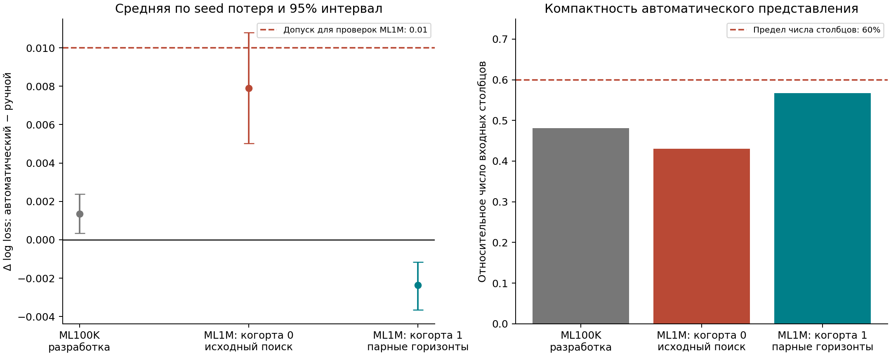

# Автоматический поиск временных признаков для рекомендаций

[](https://github.com/gimacorp/recsys-auto-features/actions/workflows/checks.yml)

Решение исследовательского задания об автоматизации feature engineering в рекомендательных системах: сильный CatBoost, причинно корректные агрегаты, поиск пакетов признаков и воспроизводимое сравнение.

**На заранее выделенной когорте MovieLens 1M автоматический поиск с парными горизонтами получает log loss 0.537773 против 0.540127 у ручного CatBoost**, используя в среднем **60.67 столбца против 107** — сокращение на **43.3%**. Парный пользовательский 95%-интервал разности средней по трём seed потери: **[−0.003655; −0.001165]**. Каталоговое ранжирование сохраняет отдельный компромисс качества, подробно разобранный в отчёте.

[Полный отчёт](docs/report.md) · [Все результаты](docs/generated_results.md) · [Воспроизведение](docs/reproduction.md) · [Алгоритм](docs/method.md)

## Задача и метод

MovieLens 100K содержит 100 000 оценок с timestamp и жанрами фильмов. Цель — вероятность `rating >= 4` среди наблюдаемых оценок. Пакет признаков задаётся сущностью и временным окном: user, item, genre, user×genre, user×item; агрегаты включают количество событий, положительность, среднюю оценку и давность.

Направляемый поиск предлагает пакеты по корреляции с остатками текущего CatBoost. Каждое предложение проверяется полноценным обучением; принятие определяется validation log loss. Случайный контроль имеет ту же процедуру и число проверок. Два режима поиска: дополнение сильного ручного набора и построение исторических признаков с исходной статической моделью.

Все исторические признаки используют события со временем **строго меньше** времени запроса. Одинаковые timestamp обрабатываются атомарно. Тестовые периоды исключены из выбора гиперпараметров, числа деревьев и признаков.

## Разработка на MovieLens 100K

Среднее по двум временным разбиениям и трём seed. Каталоговая NDCG использует историю, зафиксированную на начале тестового периода, и весь доступный каталог.

| Метод | Log loss ↓ | ROC AUC ↑ | NDCG@10 каталога ↑ |
| --- | --- | --- | --- |
| Статические признаки | 0.646078 | 0.667099 | 0.132098 |
| Ручные признаки | 0.574194 | 0.763321 | 0.218776 |
| Ручные + случайный поиск | 0.574557 | 0.763069 | 0.219135 |
| Ручные + направляемый поиск | 0.574157 | 0.763199 | 0.209219 |
| Все пакеты | 0.574297 | 0.763406 | 0.211309 |
| Построение с нуля: случайное | 0.576374 | 0.761555 | 0.216487 |
| Построение с нуля: направляемое | 0.575545 | 0.761945 | 0.199091 |

Направляемое дополнение даёт малое среднее улучшение log loss; знак эффекта меняется между seed. Построение с нуля сокращает число признаков примерно на 52%, сохраняя близкий log loss, и снижает каталоговую NDCG. Эти результаты показывают применимость автоматизации и необходимость выбирать признаки под целевую метрику сервиса.


## Независимые проверки и итоговый метод

Исходный компактный метод проверен на первой когорте MovieLens 1M. Верхняя граница потери 0.010794 превышает заранее заданный допуск 0.01; ухудшение усиливается на поздней части теста. Затем сформулирован и отдельно проверен вариант, который автоматически включает полную историю выбранной сущности вместе с коротким окном и ограничивает число столбцов 60% ручного baseline.

| Этап | Ручной log loss | Автоматический log loss | Столбцы: ручной / автоматический |
| --- | --- | --- | --- |
| MovieLens 100K: разработка | 0.574194 | 0.575545 | 108 / 52 |
| MovieLens 1M: когорта 0, исходный поиск | 0.551018 | 0.558924 | 107 / 46 |
| MovieLens 1M: когорта 1, парные горизонты | 0.540127 | 0.537773 | 107 / 60.67 |

Протоколы [первой новой когорты](docs/external_protocol.md) и [парных горизонтов](docs/paired_protocol.md) зафиксированы до соответствующих результатов. Когорты имеют непересекающиеся пользовательские истории. Итоговый метод выполнил оба критерия: ограничение числа столбцов и верхней границы прироста log loss. Разность направляемого и случайного парных методов остаётся неопределённой; вклад all-history объединения требует отдельной абляции на одной когорте.

NDCG@10 полного известного каталога итогового метода — 0.188550 против 0.196160 у ручного baseline. Преимущество относится к классификационной потере в последовательном режиме оценки. Полные таблицы: [первая когорта](docs/external/generated_results.md), [репликация](docs/replication/generated_results.md). [Повторная проверка](docs/review.md) описывает исправления и развитие гипотезы.



## Что проверено

- Полный MovieLens 100K и две когорты MovieLens 1M: 171 470 и 172 119 оценок, с сохранением целых пользовательских историй.
- Seed 17/42/73, шесть конфигураций базового CatBoost на каждый fold и 993 проверки предложений признаков во всех исследованиях.
- Log loss, ROC AUC, Brier score, NDCG@10, Recall@10 и парные bootstrap-интервалы по пользователям.
- Ранжирование всего известного каталога, warm/cold-user сегменты, абляции четырёх семей признаков и замороженная история.
- Тесты исторического oracle, мутации будущих меток, парного поиска, границ бюджета, изоляции запусков и атомарной записи; аудит метрик и воспроизведения.

Генератор дополнительных горизонтов выводит окна из распределения интервалов только на train. Эта автоматизация пространства кандидатов исследована отдельно на MovieLens 100K с явно обозначенным exploratory статусом.

Основной протокол зафиксирован [до тестовых результатов](docs/protocol.md). [Дополнительные исследования](docs/additional_protocol.md) явно отделены по времени постановки. [Проверка готового проекта](docs/verification.md) включает установку и запуск из свежего клона. Исходные данные, локальные модели и индивидуальные предсказания исключены из Git; опубликованы конфигурации, полные журналы попыток и агрегированные результаты.

## Быстрый запуск

Python 3.13 рекомендуется для воспроизведения; CI также проверяет Python 3.11. Используется CPU.

```bash
git clone https://github.com/gimacorp/recsys-auto-features.git
cd recsys-auto-features
python3 -m venv .venv
source .venv/bin/activate
python -m pip install -e '.[dev]'
pytest -q
recsys run --config configs/smoke.json --output artifacts/smoke-local
```

Полное исследование:

```bash
recsys run --config configs/full.json --output artifacts/reproduced
python -m recsys_auto.audit --experiment artifacts/reproduced
python -m recsys_auto.from_static --experiment artifacts/reproduced
python -m recsys_auto.catalogue --experiment artifacts/reproduced
python -m recsys_auto.diagnostics --experiment artifacts/reproduced
python -m recsys_auto.report --experiment artifacts/reproduced --output docs/reproduced
```

Полные настройки окружения, команды независимых проверок, продолжение прерванного запуска и описание артефактов: [docs/reproduction.md](docs/reproduction.md). Модели и предсказания автоматически сохраняются в `models/` и `predictions/` внутри каталога соответствующего запуска.

## Навигация

| Путь | Содержание |
| --- | --- |
| `src/recsys_auto/` | Загрузка, признаки, модели, поиск, оценка, аудит и генерация отчёта |
| `configs/` | Зафиксированные бюджеты полного, короткого и дополнительного экспериментов |
| `tests/` | Независимый oracle и проверки временных границ, истории, метрик и поиска |
| `artifacts/full/` | Разработка и дополнительные проверки MovieLens 100K |
| `artifacts/external/` | Первая независимая когорта MovieLens 1M |
| `artifacts/replication/` | Отдельная проверка парных горизонтов с ограничением сложности |
| `docs/report.md` | Постановка, результаты, объяснения и ограничения |
| `docs/defense.md` | Разбор технических решений для обсуждения работы |

## Данные и ограничения

Данные предоставлены [GroupLens](https://files.grouplens.org/datasets/movielens/ml-100k-README.txt). F. Maxwell Harper, Joseph A. Konstan. *The MovieLens Datasets: History and Context*, 2015, [DOI](https://doi.org/10.1145/2827872). Загрузчик проверяет SHA-256 официального архива.

Результаты относятся к селективно наблюдаемым оценкам небольшого датасета. Основной режим предполагает немедленную доступность feedback. Грамматика задаёт конечное пространство поиска, а batch-движок материализует все кандидаты. Перенос в сервис следует проверять на журнале показов с задержками отклика, заранее выбранной ранжирующей метрикой и отдельным будущим периодом.
