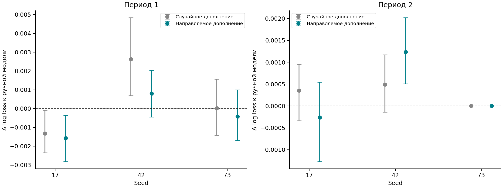
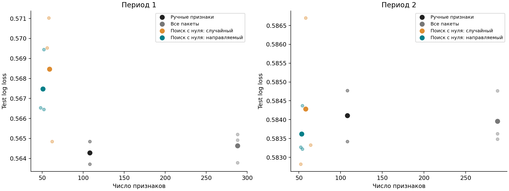
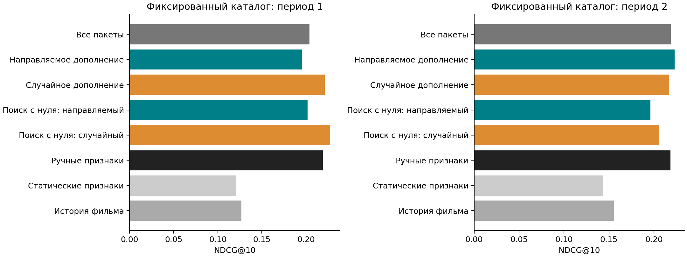

# Автоматизация исторических признаков в рекомендательной модели

## Результат исследования

Реализован воспроизводимый поиск признаков по грамматике сущностей, агрегатов и временных окон. Эксперимент с исходными статическими признаками автоматически строит модель со средними **52 признаками** и **log loss 0.575545**. Ручной CatBoost использует **108 признаков** и достигает **0.574194**. Число выбранных признаков уменьшается примерно на 52%, абсолютная разница log loss составляет 0.001351.

Направляемое дополнение сильной ручной модели достигает среднего log loss 0.574157. Разница с ручной моделью мала и меняет знак между отдельными запусками. Результаты поддерживают применимость автоматического построения компактных наборов признаков; доказательство устойчивого превосходства направляемого поиска требует дальнейших экспериментов.

Полный каталог, замороженная история и абляции показывают ограничения оптимизации одной классификационной метрики. Все попытки поиска, seed, параметры и интервалы опубликованы в [артефактах](../artifacts/full). Подробные численные таблицы: [generated_results.md](generated_results.md).

## 1. Постановка

Исходная таблица содержит пользователя, фильм, время и оценку. Цель — предсказать положительный отклик `label = 1[rating >= 4]`. Поиск должен автоматизировать выбор исторических агрегатов, сохраняя корректность по времени и возможность сравнения с ручным feature engineering.

Основная гипотеза: связь нового признака с остатками текущей модели позволяет экономнее расходовать бюджет обучения при выборе дополнительных пакетов. Дополнительный вопрос: может ли поиск самостоятельно построить полезные исторические признаки, начиная со статических данных.

Вклад работы состоит в связке декларативной грамматики, строгого исторического движка, проверяемого поиска и нескольких протоколов оценки. Направление по остаткам используется как простая исследуемая эвристика. Грамматика задаёт пространство автоматизации и сохраняет возможность переноса выбранных пакетов в SQL.

## 2. Данные

Используется полный MovieLens 100K: 100 000 оценок, 943 пользователя, 1 682 фильма. Положительность задаётся оценками 4–5; оценки 1–3 образуют отрицательный класс. Для фильмов доступны 19 жанровых индикаторов, для пользователей — возраст, пол и род занятий.

Оценки являются селективно наблюдаемым feedback. Вероятностная задача характеризует предпочтения среди оценённых фильмов. Отсутствующий рейтинг имеет неизвестную полезность. Для оценки извлечения будущих положительных взаимодействий дополнительно используется полный доступный каталог.

Прямые пары user–item встречаются по одному разу. Соответствующие исторические признаки остаются константными и исключаются по train. Жанры многозначны: фильм входит в историю каждого своего жанра. Исходный архив скачивается с GroupLens, проверяется по SHA-256 и исключён из Git. Подробнее: [данные и допущения](data.md).

## 3. Протокол и причинная корректность

Основной протокол [зафиксирован до тестовых результатов](protocol.md). События сортируются по времени; границы проходят между различными timestamp.

| Fold | Train | Validation | Test |
| --- | --- | --- | --- |
| 0 | 49 998 событий | 15 002 события | 14 999 событий |
| 1 | 65 000 событий | 14 999 событий | 20 001 событие |

Тестовые периоды разделены: первый — с 26 января по 7 марта 1998 года, второй — с 7 марта по 22 апреля 1998 года. Точные границы в UTC сохранены в [folds.json](../artifacts/full/folds.json). Второй fold использует расширенную обучающую историю; его validation совпадает с более ранним тестовым периодом. Метрики каждого fold отражают свой временной сдвиг.

Историческое окно задаётся условием `t - window <= timestamp < t`. Текущий отклик и одновременные отклики исключаются. При последовательной оценке более ранний фактический feedback из validation/test пополняет историю. Это предполагает его немедленную доступность. Замороженная история отдельно проверяет чувствительность к этому допущению.

Гиперпараметры, окна и число деревьев выбираются по train/validation. Финальная модель обучается на train+validation с зафиксированным числом деревьев; тестовая метка используется для вычисления метрик. Дополнительные эксперименты с каталогом, абляциями и построением с нуля обозначены как исследовательские: они сформулированы после запуска основной проверки и используют те же тестовые периоды. Их протокол приведён [отдельно](additional_protocol.md).

## 4. Базовая модель

Используется CatBoostClassifier с log loss. В ручной модели предусмотрены user/item/genre/user×genre/user×item истории и окна 7/30/90 дней/вся история. Постоянные на train признаки удаляются; итоговый baseline содержит 108 столбцов.

Шесть сочетаний параметров проверяют глубины 4/6/8, learning rate 0.05/0.1 и L2-регуляризацию 3/10. Максимум — 500 деревьев, early stopping — 40 итераций. Это ограниченный воспроизводимый подбор с полным журналом, который учитывает вычислительный бюджет. Для fold 0 выбраны depth=6, learning_rate=0.05, l2_leaf_reg=3; для fold 1 — depth=4, learning_rate=0.05, l2_leaf_reg=3.

Гиперпараметры первого seed каждого fold фиксируются для всех его сравнений. Каждый метод выбирает число деревьев на validation. Seed: 17, 42, 73. Категориальные идентификаторы обрабатываются встроенным one-hot с порогом 2000; историческая target-информация представлена явными причинными агрегатами.

Контроли: сглаженная история положительности фильма, бустинг со статическими признаками и бустинг со всеми доступными пакетами. Совместные настройки моделей позволяют исследовать эффект представления признаков.

## 5. Автоматизация

Пакет признаков определяется сущностью и окном. Скалярные пакеты содержат log-count, сглаженную положительность, сглаженную среднюю оценку и время с последнего события. Жанровые пакеты объединяют признаки всех жанров через среднее, минимум и максимум. Приоры фиксированы: вероятность 0.5, оценка 3, вес 5 наблюдений.

Дополнительные окна основного поиска: 1, 3, 10, 14, 21, 45, 60, 120, 180 дней. Всего заданы 45 дополнительных пакетов. После исключения констант оба метода получают одинаковый пул.

Направляемый поиск рассчитывает на validation остаток `r = y - p`. Скор пакета — максимальная абсолютная корреляция его признаков с остатком. Три лучших ещё не проверенных пакета проходят полноценное обучение; лучший принимается при снижении log loss минимум на 0.0001. Остатки затем обновляются. Пять раундов дают 15 обучений. Случайный контроль отличается стратегией предложения и сохраняет остальные настройки.

Поиск с исходными статическими признаками получает объединение ручных и дополнительных окон: 65 пакетов. Восемь раундов дают 24 проверки на fold/seed. Стартовая модель этого эксперимента использует только статические признаки.

Расчёт использует сортировку по ключам, префиксные суммы и бинарный поиск границ. Все кандидаты материализуются заранее; выбор пакетов уменьшает итоговую модель, а затраты первоначального вычисления относятся ко всему пулу. Полное описание: [method.md](method.md).

## 6. Основные результаты

Таблица показывает равновзвешенное среднее по двум fold и трём seed. Основная метрика — log loss; NDCG@10 здесь вычислен внутри наблюдаемого набора фильмов пользователя. В ранжирование входят пользователи с минимум двумя оценками и обеими метками в соответствующем периоде.

| Метод | Log loss ↓ | ROC AUC ↑ | NDCG@10 ↑ |
| --- | --- | --- | --- |
| Статические признаки | 0.646078 | 0.667099 | 0.763148 |
| Ручные признаки | 0.574194 | 0.763321 | 0.781494 |
| Ручные + случайное дополнение | 0.574557 | 0.763069 | 0.781630 |
| Ручные + направляемое дополнение | 0.574157 | 0.763199 | 0.784107 |
| Все пакеты | 0.574297 | 0.763406 | 0.781402 |
| Поиск с нуля: случайный | 0.576374 | 0.761555 | 0.781091 |
| Поиск с нуля: направляемый | 0.575545 | 0.761945 | 0.785217 |

Исторические признаки дают большой выигрыш относительно статической модели. Направляемое дополнение ручной модели снижает средний log loss примерно на 0.000037, а случайное дополнение в среднем повышает его. Разность направляемого и случайного дополнения меняет знак между seed; преимущество в среднем требует осторожной интерпретации.

Парный bootstrap ресемплирует пользователей целиком 1000 раз. В fold 0 / seed 17 направляемое дополнение улучшает log loss на 0.001566 с 95%-интервалом разности примерно [−0.002816; −0.000366]. В fold 1 / seed 42 разность +0.001233 имеет интервал [+0.000505; +0.002018]. Это демонстрирует реальные случаи улучшения и ухудшения. Интервалы относятся к конкретному запуску; множественные сравнения и зависимость временных периодов ограничивают обобщение.

## 7. Построение компактной модели

Направляемый поиск с исходной статической моделью выбирает в среднем 52 столбца: около половины ручного набора. Его средний log loss 0.575545 близок к 0.574194 ручной модели. Случайный поиск выбирает в среднем 58.33 столбца с log loss 0.576374. Здесь компактность означает размер итогового набора; грамматика и предварительное вычисление кандидатов сохраняют свои затраты.

В первом периоде направляемый поиск с нуля получает log loss 0.567472 против 0.564278 у ручного baseline. Во втором — 0.583619 против 0.584110. Это показывает чувствительность автоматического отбора к временному периоду.

Повторяющиеся выбранные пакеты: пользовательско-жанровые окна, долгосрочные товарные окна и пользовательские агрегаты. Например, fold 1 / seed 17 выбирает `user_genre__60d`, `item__180d`, `user__120d`, `user_genre__120d`, `user__90d`. В первом периоде часто выбираются краткосрочные пользовательские окна. Эти наблюдения описывают работу алгоритма; причинные объяснения предпочтений пользователей потребовали бы отдельной проверки.

## 8. Проверки постановки и механизма

**Ранжирование каталога.** На начале test фиксируется история, ранее оценённые фильмы пользователя исключаются. Каталог содержит 1562 фильма в первом периоде и 1616 во втором. Доступный ground truth имеется у 209 и 287 пользователей. Покрытие положительных событий составляет около 99.2%. Такой протокол оценивает извлечение будущих положительных взаимодействий среди всех доступных кандидатов.

Ручная модель получает NDCG@10 0.219217 и 0.218335 по периодам. Направляемое дополнение — 0.195395 и 0.223043. Ранний период показывает ухудшение, поздний — улучшение. Сглаженная история фильма даёт 0.126846 и 0.155321: преимущество ручной персонализированной модели становится заметным на каталоге. Внутри селективно наблюдаемых оценок этот простой контроль, напротив, имеет высокую NDCG. Различие подчёркивает роль протокола и состава кандидатов.

Для построения с нуля случайный поиск получает каталоговую NDCG@10 0.227213 и 0.205761; направляемый — 0.201888 и 0.196295. Таким образом, компактный набор с близким log loss имеет заметную потерю качества ранжирования каталога. Целевую метрику выбора признаков следует согласовать с будущим режимом применения. Набор пользователей и история в каталоговом протоколе отличаются от последовательной оценки наблюдаемых кандидатов, поэтому абсолютные NDCG между этими постановками сравниваются с учётом обеих причин.

**Абляции.** Для seed 17 удаление истории фильма увеличивает log loss приблизительно на 0.0304 и 0.0279 по двум периодам. Удаление пользовательско-жанровой истории увеличивает его примерно на 0.0078 и 0.0036. Глобальные жанровые агрегаты дают менее устойчивый эффект. В этих данных сильная модель опирается на качество фильма и предпочтения пользователя по жанрам.

**Доступность feedback.** Замороженная ручная модель получает log loss 0.623624 и 0.624525 против последовательных 0.564846 и 0.584772 для того же seed. Доступность оценок внутри периода существенно влияет на результат. Эта разность также включает фиксацию временных признаков; она служит проверкой чувствительности всего режима оценки.

**Проверяемость.** Исторический движок сравнивается с независимым простым oracle, включая повторные взаимодействия, все сущности, границы окна и одинаковые timestamp. Мутация одновременных и будущих меток сохраняет прошлые признаки. Аудит пересчитывает 252 значения основных метрик из локальных предсказаний, проверяет 12 бюджетов поиска и четыре временные границы. Восстановленные автоматические модели также проверены по всем сохранённым тестовым метрикам.

## 9. Вычислительная стоимость

Матрица всех кандидатов для 100 000 событий рассчитывается примерно за 3.37 секунды в зафиксированном окружении. Основной эксперимент занял около 6.35 минуты; построение с исходной статической моделью — около 6.43 минуты. Дополнительные проверки частично выполнялись одновременно; время отражает нагрузку текущей машины. Таблицы содержат стоимость каждого обучения и дополнительного скоринга.

У двух стратегий одинаковое число дорогих проверок: 15 в основном эксперименте и 24 при построении с нуля. Направляемая стратегия дополнительно сканирует числовые кандидаты на validation. Число деревьев и выбранных столбцов влияет на реальную длительность каждого обучения.

Batch-реализация имеет память порядка O(NP) для N событий и P признаков. Она подходит для воспроизводимого исследования на данном датасете. Промышленная версия для миллиардов событий потребует распределённых агрегатов, состояния по ключам, вычисления пакетов по требованию и скоринга на подвыборке. Число итоговых столбцов также следует дополнить метриками стоимости обслуживания пакетов.

## 10. Ограничения и дальнейший эксперимент

Размер и механизм сбора MovieLens ограничивают перенос результатов на клики, покупки и промышленный каталог. Пользовательские профили и жанры считаются известными статическими метаданными. Немедленная доступность оценок важна для основного режима. В задаче ранжирования каталога неизвестная полезность остальных фильмов кодируется нулём только для ретроспективной метрики.

Грамматика ограничивает автоматизацию пятью сущностями, фиксированными агрегатами и сеткой окон. Поиск по validation допускает переобучение на выборе признаков; порог улучшения фиксирован и имеет эвристический характер. Тюнинг бустинга ограничен шестью конфигурациями. Три seed и два периода дают полезную проверку устойчивости, а для новых вариантов алгоритма потребуется новый отложенный набор данных.

Следующий эксперимент стоит провести на журнале показов с явными отрицательными откликами: заранее зафиксировать ранжирующую целевую метрику, учитывать задержку feedback, применить nested temporal validation и добавить стоимость пакета в критерий отбора. Полученный автоматический набор следует оценить на отдельном будущем периоде при том же режиме обновления истории, который планируется для сервиса.

## Источники и воспроизведение

Данные: [GroupLens MovieLens 100K](https://files.grouplens.org/datasets/movielens/ml-100k-README.txt). Цитирование: F. Maxwell Harper, Joseph A. Konstan, *The MovieLens Datasets: History and Context*, ACM TiiS, 2015, [DOI](https://doi.org/10.1145/2827872). Модель: [CatBoost, настройка параметров](https://catboost.ai/docs/en/concepts/parameter-tuning).

Все команды установки, экспериментов, аудита и генерации таблиц: [reproduction.md](reproduction.md). Описание грамматики и алгоритма: [method.md](method.md). Полные результаты всех попыток: [artifacts/full](../artifacts/full).
